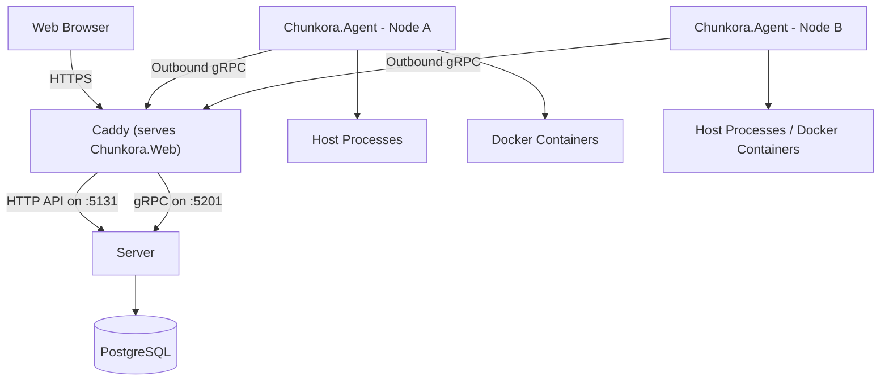

<h1>
  
  Chunkora
</h1>

> An open-source, self-hosted control panel for managing applications across multiple nodes.


[](https://github.com/Vaelow233/Chunkora/actions/workflows/build.yml)
[](LICENSE)

[Features](#features) · [Getting Started](#getting-started) · [Architecture](#architecture) · [Development](#development)

**Chunkora** provides a unified web interface for managing native processes and Docker containers across multiple machines. It is suitable for game servers, bots, background services, and other self-hosted applications.

Each managed application is called an **instance**. Instances run on nodes managed by the Chunkora (Agent), either as native processes or Docker containers.

> Chunkora is under active development. Features and deployment instructions may change.

## Features

- **Unified instance management:** Create and configure host-process and Docker instances, view their status and console output, and start, stop, force-stop (kill) or send commands to them from the web interface.
- **Task automation:** Schedule instance actions using one-time, interval-based, Cron, or agent-startup triggers. Actions include starting, stopping, restarting, force-stopping, and sending commands to instances.
- **Multi-node management:** Connect agents running on different machines to a central server and manage their instances from one panel. A public accessible inbound endpoint on every managed node is not required.
- **Granular access control:** Manage users and roles with fine-grained permissions, including wildcard-based permission patterns.
- **Built-in file manager:** Browse instance directories, upload and download files, create, rename, copy, move, and delete files and folders, and edit text files in the browser.
- **Node monitoring:** View node connectivity, system information, and historical CPU and memory usage.
- **Self-hosted deployment:** Run the control plane on your own server with Docker Compose, PostgreSQL, and Caddy.

## Getting Started

### Prerequisites

- Git
- Docker Engine and Docker Compose v2
- Two DNS names pointing to the control-plane host (web interface and agent endpoint)
- Inbound TCP ports `80` and `443` for the default HTTPS setup

### 1. Deploy the control plane

Clone the repository and create the environment file:

```bash
git clone https://github.com/Vaelow233/Chunkora.git
cd Chunkora
cp .env.example .env
```

Configure the following variables in `.env`:

| Variable                        | Description                                              |
|---------------------------------|----------------------------------------------------------|
| `POSTGRES_PASSWORD`             | PostgreSQL password                                      |
| `ConnectionStrings__PostgreSQL` | PostgreSQL connection string; using the same password    |
| `BootstrapAdmin__Password`      | Initial administrator password                           |
| `CHUNKORA_WEB_DOMAIN`           | Web domain, e.g. `chunkora.example.com`                  |
| `CHUNKORA_AGENT_DOMAIN`         | Agent endpoint domain, e.g. `agent.chunkora.example.com` |

Use strong, unique passwords and keep `.env` private. The bootstrap password is required when initializing an empty user database.

Build and start the services:

```bash
docker compose up -d --build
```

The default deployment includes the server, PostgreSQL, and the web interface. Database migrations run automatically on startup. Caddy serves the frontend, proxies API and gRPC requests, and manages HTTPS when DNS and network settings are configured correctly.

Open `https://<your-web-domain>` and sign in as `admin` with the configured bootstrap password.

### 2. Connect a node

1. Create a node in the web interface.
2. Retrieve its agent token from **Secret Information** on the node details page.
3. Install the .NET 10 SDK on the managed machine and clone the repository. To build the agent for Linux x64, run:

   ```bash
   dotnet publish Chunkora.Agent/Chunkora.Agent.csproj \
     -c Release -r linux-x64 -o ./agent-publish
   ```

   Adjust the runtime identifier for other platforms or architectures.

4. Set the server address and agent token, then start the agent. For example, on Linux:

   ```bash
   cd agent-publish
   export Agent__ServerAddress=https://agent.chunkora.example.com
   read -rsp 'Agent token: ' Agent__Token; echo
   export Agent__Token
   ./Chunkora.Agent
   ```

   Replace the example domain with your agent endpoint. The agent requires outbound access to this endpoint.

5. Verify that the node is online in the web interface.

For Docker instances, install Docker on the node and grant the agent account appropriate access. To manage native host processes, run the agent directly on the host. For persistent deployments, use a service manager and store agent credentials securely.

### 3. Create an instance

Open the **Instances** page, create an instance on a connected node. Start the instance and open its details to access the console, files, settings, and scheduled tasks. The runtime can be changed in **Settings** page.

Currently, Chunkora can't pull the image automatically. If you want to use Docker as the runtime, an image should be pulled and ready to use on the node.

## Architecture

Chunkora consists of four components:

| Component | Description |
| --- | --- |
| [`Chunkora.Server`](Chunkora.Server) | Central API, authentication, authorization, persistent state, and agent communication. |
| [`Chunkora.Agent`](Chunkora.Agent) | Instance operations, file access, task execution, and system metrics on each node. |
| [`Chunkora.Web`](Chunkora.Web) | React-based management interface. |
| [`Chunkora.Contracts`](Chunkora.Contracts) | Shared Protocol Buffers and gRPC contracts. |



Agents establish authenticated connections to the server and execute operations on their respective nodes. The server stores persistent state in PostgreSQL.

## Development

### Technology stack

| Layer | Technologies |
| --- | --- |
| Backend | C#, .NET 10, ASP.NET Core, Entity Framework Core |
| Agent | .NET Worker Service, Docker.DotNet, Cronos |
| Communication | gRPC, Protocol Buffers, HTTP API |
| Frontend | React 19, TypeScript, Vite, TanStack Router and Query, shadcn/ui, Tailwind CSS |
| Database | PostgreSQL |
| Deployment | Docker Compose, Caddy |

To build the .NET solution locally:

```bash
dotnet restore Chunkora.sln
dotnet build Chunkora.sln
```

To work on the frontend, install Node.js 24 and pnpm, then run:

```bash
cd Chunkora.Web
pnpm install --frozen-lockfile
pnpm dev
```

Build the frontend for production with `pnpm build`. Run the backend with a configured PostgreSQL database when developing the frontend against it. The API proxy has been configured with an address of `http://localhost:5131`. To change this, overwrite the `DEV_API_TARGET` environment variable.

## License

Chunkora is distributed under the [Apache License 2.0](LICENSE).
